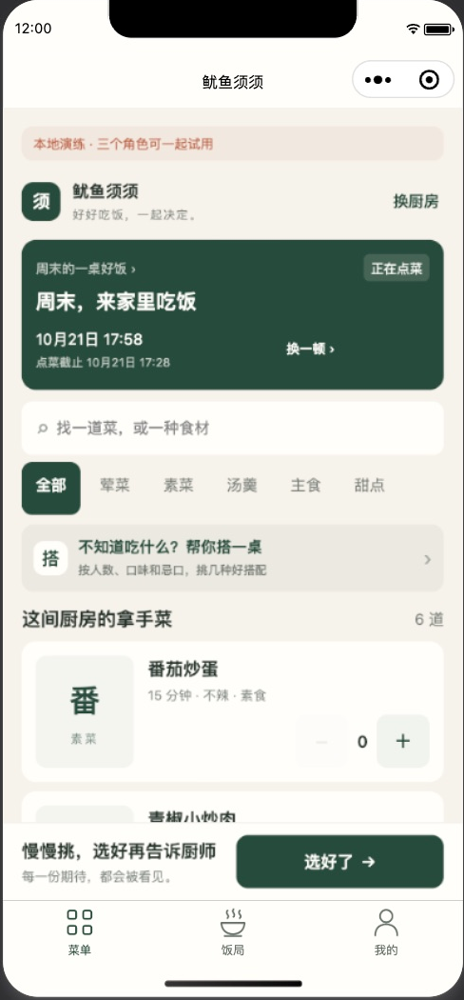
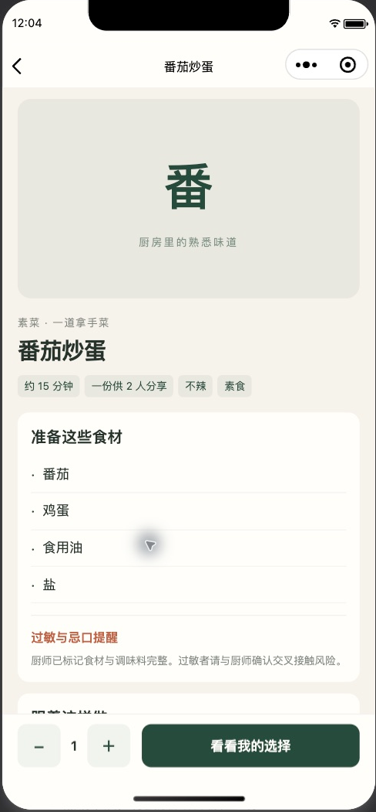

# 功能补全与界面改版实施记录

> 本文保留0.2.0的业务补全与云接入证据；后续0.2.1的紧凑字号、图标、卡片和同设备截图见[紧凑界面实施记录](20261021_04_紧凑界面实施记录.md)。

## TL;DR

- 免费第一期已补到12个原生页面，新增独立菜谱详情、完整饭局历史、编辑草稿、跨次访问撤销全部邀请和公开摘要，以及一键三人演练。
- 菜单突出当餐、搜索、分类和选菜；掌勺、个人选择、邀请管理分别展示。内部金额默认折叠，朋友接口仍不返回价格。
- `npm run check` 通过65项测试；主工程与四个云函数依赖审计均为0项漏洞。测试使用独立 mock 数据，不创建虚构云端微信身份。
- 原生开发者工具走通加菜、详情、锁单、确认实际份数、开始制作、逐菜上桌。真实多微信、图片审核回调、订阅消息与正式发布仍未验收。
- 本次沿用免费开发环境，不开通付费、不添加其他微信账号。图片和通知缺少平台配置时明确显示不可用，文字菜谱与核心饭局仍可使用。

## 部署坐标

版本为0.2.0；四个函数为`api`、`publicRead`、`platformCallback`、`maintenance`，运行时为Node.js 20.19。环境标识、AppID和秘密配置只保存在本地与平台。数据库25个集合及存储的客户端直读写拒绝证据来自2026-10-20的真实开发环境检查；本次未修改这些规则。

本地Node.js 24.10.0，CI使用Node.js 22。开发者工具Stable 2.02.2608080，基础库3.17.4；工具有灰度基础库和资源预加载提示，未据此宣称真机兼容通过。

2026-10-21更新回执：四个函数部署均成功，平台回读均为`Active / Nodejs20.19 / 3秒`。0.2.0开发代码上传成功，主包171274字节（工具显示167.3KB）。这是开发版本上传，未设为体验版，未提交正式审核或发布。

## 各项落地

| 入口 | 实际行为 |
|---|---|
| 菜单与菜谱详情 | 压缩首屏，统一分类、份数按钮和固定底栏；详情展示食材、步骤、供餐人数与过敏提醒。非本餐菜单的厨房菜谱可读，但不能混入当餐选择。 |
| 饭局与历史 | 完整访问最多40场饭局，可按厨房、状态和名称筛选，切换时同时更新厨房上下文；不再受六项操作菜单限制。 |
| 掌勺台 | 同时显示提交选择数、代表人数、请求份数；锁单后另行确认实际制作份数。逐菜开始、上桌、不做及最近一次撤销均沿用状态机。 |
| 私有金额 | 厨师金额折叠显示；本餐改价保留未保存输入，轮询不能覆盖；版本冲突时明确重载最新值后再改。交接后清掉旧角色的金额与管理状态。 |
| 菜谱与发布表单 | 文字草稿按身份、厨房、菜谱隔离保存7天；进入时询问恢复或放弃。草稿不保存图片和内部价格，保存成功即清理。 |
| 邀请与公开摘要 | 可撤销本餐所有历史邀请或摘要，即使已离开页面、丢失本机短码仍可撤销。服务端递增版本，旧链接失效，新生成的链接有效。 |
| 推荐 | 常用人数与忌口优先，更多偏好折叠；改变条件立即清掉旧方案，丢弃旧条件的迟到响应，避免拿旧忌口结果提交。 |
| 分享图 | 实际画布生成可预览的菜单图。无小程序码能力时明确标为无扫码入口；静态图片无法因撤销链接而收回。 |
| 我的与隐私 | 昵称编辑、厨房列表、历史、邀请、反馈、个人导出和注销。导出文件由用户主动选收件人，本轮未发送消息或文件给他人。 |
| 本地演练 | 一键准备六道菜与两位朋友，通过实际业务接口创建；重复执行不重复建厨房或饭局。重置只清演练数据，保留云端身份缓存。 |

菜谱图片仍由服务端审核与私有存储控制。未完成真实回调来源验证前不开放云上传；不能用本地模拟审核作为正式放行证据。

## 界面截图

菜单与菜谱详情均来自原生开发者工具的本地演练界面，截图不代表手机验收。

| 菜单 | 菜谱详情 |
|---|---|
|  |  |

## 验收证据

| 层次 | 结果与边界 |
|---|---|
| 类型、构建、文件完整性 | `npm run check`成功，12页原生文件齐全；最终本机配置为cloud，测试自身在临时目录编译demo，不改变设备数据。 |
| 自动化业务与页面 | 65项通过，0失败；覆盖三人示例幂等、详情保留人数与备注、超过6场历史、草稿隔离、价格并发、推荐迟到、角色交接与全部撤销兼容旧链接。 |
| 依赖 | 主工程及四个云函数分别审计均为0项漏洞。Linux部署目录单独安装依赖，`lodash.set/unset`使用压缩包，避免云平台将本地目录依赖变成无效链接。 |
| 原生工具 | 点菜0→1、菜谱详情、两份选择代表3人、请求2份、锁单、实际2份、开始制作及1道已上桌均有界面回读。 |
| 真实开发云 | 2026-10-20已验证SDK身份、建厨房/菜谱/饭局/邀请/选菜回读、25集合直读写拒绝、回调和维护函数拒绝客户端来源；与本轮mock证据分别保留。 |
| 真实手机 | 未执行两台手机三个微信账号测试；本轮按用户要求不新增微信成员。 |

本机原始日志保存在被Git忽略的`artifacts/ui-20261021/`；公开仓库不包含身份、密钥、原始诊断数据或内部环境坐标。

上传前遇到开发者工具旧文件索引报告找不到实际存在的`app.json`。清理编译/文件缓存和重置索引未恢复；采用最终云构建的逐文件一致副本上传后成功。构建已改为先在临时目录生成，再就地更新文件及移除过期文件，保留应用根目录和已有`app.json`，并以真实文件inode断言回归。原工具窗口未为此重开或移动，后续本机预览若仍遇旧索引，需要重新打开项目；这不影响已成功上传的开发代码。未将该缓存问题说成业务代码故障。

## 偏离与剩余事项

| 事项 | 影响与证据 | 为何不阻塞本次代码与开发版本 | 后续动作及责任 |
|---|---|---|---|
| 两机三账号与微信分享 | 目前只有隔离mock与原生工具证据，未证明真实多人同步、双端卡片和弱网 | 用户明确先不添加其他微信、先用mock测试 | 用户准备体验成员后，由开发执行真实并发、弱网、越权与双端分享验收；正式上线前必过 |
| 图片审核回调 | 可信回调来源及上传强杀后的孤儿回收没有真实证据 | 云图片保持关闭，文字菜谱正常可用 | 开发核实平台事件路径并完成正常、违规、早到、重复、超时与强杀演练，全部通过后再启用 |
| 订阅提醒 | 无真实模板、拒绝与耗尽、送达证据 | 模板缺失即禁用，饭局页面可直接看进度 | 用户选择账号可用模板，开发核验字段并完成真实授权和发送测试 |
| 小程序码与朋友圈 | 真实码和朋友圈路径未验；静态图片不会被撤销收回 | 分享图真实生成并明确无扫码入口，邀请逻辑可独立验证 | 开发在实际发布路径与Android/iOS上验证；平台能力确认后启用 |
| 维护任务真实执行 | 已配置每5分钟触发，代码按1.8秒软预算轮转，但缺独立平台执行回执 | 现阶段图片关闭、样本仅开发数据；不宣称清理与提醒已经自动完成 | 开发补平台定时触发回执与游标推进证据；涉及正式保留期、删除承诺和通知前必须完成 |
| 云备份恢复 | 本地隔离恢复通过，真实数据库与文件恢复未演练 | 本轮只交付开发体验版 | 开发在独立云环境完成恢复并重新鉴权，不覆盖现有环境 |
| 备案、类目、名称、正式审核 | 无正式发布回执 | 本轮未授权正式发布 | 用户完成平台必要确认，开发协助提审并以实际回执结算 |

不以本地全绿、云函数Active或上传成功替代真实用户验收。已有0.1.1开发版本作为前版记录；数据库兼容旧邀请与摘要，旧记录缺少版本字段按0处理。
