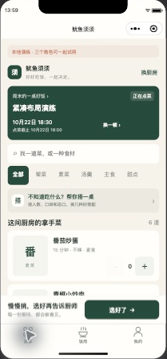
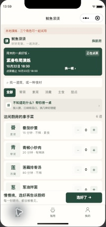

# 紧凑界面实施记录

## TL;DR

- 0.2.1统一缩小字体、图标、卡片、图片区、圆角和间距；菜品改为缩略图、说明、份数横排。
- 在同一模拟设备、同一份六道菜的演练菜单中，首屏从完整显示1张菜卡增加到3张；加菜后份数0→1及底部汇总同步更新。
- 65项回归通过，12页文件完整；微信开发者工具已实际加载菜单、饭局、厨房、发布和我的页面。
- 0.2.1开发代码已上传成功，包体170142字节（166.2KB）；本次没有服务端业务和数据契约改动。
- 原生工具及本地mock不代表两台真实手机验收。正式发布和上个版本记录的图片、提醒等外部进入条件仍沿用。

## 部署坐标

客户端版本0.2.1，原生小程序WXSS；开发者工具Stable2.02.2608080。最终本机配置已还原cloud，演练数据仅在本地。四个云函数沿用0.2.0，不因样式改动重复部署。

## 尺寸与布局变化

以下是源码中的实际尺寸；`rpx`随小程序逻辑宽度换算。没有用整页缩放或图片缩放冒充界面调整。

| 元素 | 调整前 | 调整后 |
|---|---|---|
| 全局正文 | 28rpx | 26rpx |
| 全局主标题 | 48rpx | 36rpx |
| 分区标题 | 32rpx | 28rpx |
| 通用卡片 | 内边距28、圆角24rpx | 内边距20、圆角16rpx |
| 菜单缩略图 | 160×184rpx | 104×104rpx |
| 菜卡布局 | 标题和份数上下排列 | 缩略图、说明、份数横排；长菜名可换行 |
| 加减按钮底色块 | 88×88rpx | 52×52rpx；外层点击区最小44×44px |
| 搜索框 | 高88rpx | 高68rpx |
| 分类项 | 最小高88rpx | 最小高64rpx |
| 个人头像 | 108×108rpx | 76×76rpx |
| 菜谱无图占位 | 高400rpx | 高112rpx；有图片时为260rpx |
| 底栏上下留白 | 20rpx | 12rpx，保留安全区 |

在375逻辑像素宽度下，正文为13px、菜名及分区标题14px、主标题18px；辅助信息约11–12px。底部原生tab图标通过透明留白缩小可见笔画，不改变系统tab点击范围。

菜单、饭局、厨房、个人页、历史、推荐、发布、编辑、隐私等入口共用同一套尺度。按钮与表单仍保留明确层次；加减按钮视觉面积和点击面积分别处理。

## 原生工具对比

两张图来自同一演练饭局、同一模拟设备。只裁出手机区域，没有将整页缩小后当作新设计。截图是工具缩放显示后的像素，不能用它推断手机物理屏幕清晰度。

| 调整前 | 调整后 |
|---|---|
|  |  |

## 验收与边界

| 项目 | 结果 |
|---|---|
| 类型、构建、65项测试与12页完整性 | 全部通过；未为本次可逆样式改动新增镜像测试 |
| 原生菜单 | 同一份六菜菜单，首屏完整菜卡1→3；加菜0→1，底栏同步 |
| 原生辅助页 | 厨房列表、发起饭局表单、掌勺台和我的页面均实际加载；新增演练饭局仅存本机 |
| 恢复与上传 | 紧凑源码已完整恢复，原cloud配置按备份字节还原；根目录直接上传0.2.1成功，170142字节 |
| 业务范围 | 不改鉴权、推荐、价格、份数、邀请和服务端状态机；旧样式只为同设备对比临时编译，最终已恢复 |
| GUI约束 | 复用用户放在副屏的窗口，没有主动移动、改大小或全屏 |

本地日志位于忽略目录`artifacts/density-20261021/`。代码仓不包含真实AppID、环境ID、身份缓存或CLI令牌。

## 非阻塞事项登记

| 事项 | 影响与证据 | 未阻塞原因 | 后续与责任 |
|---|---|---|---|
| 两机真机与更窄机型 | 本轮没有新的Android/iOS双端及320逻辑宽度原生截图 | 本轮是可逆前端密度调整；现有模拟设备和65项检查通过 | 开发在下次真机验收时核长菜名、系统大字体、安全区与点击范围；不宣称全机型已验 |
| 辅助HTML比较预览 | 浏览器策略拒绝file协议；未改用HTTP或其他浏览器绕过 | 已改用微信原生工具，在同设备临时编译前后样式并分别截图 | 已完成替代验证；HTML文件不作为通过证据，无待授权操作 |
| 正式平台能力 | 真实多人、图片回调、订阅提醒与正式发布仍待验收 | 本轮只交付开发版UI调整，不改变原有能力开关 | 责任与进入条件见[0.2.0实施记录](20261021_03_功能补全与界面改版实施记录.md) |
