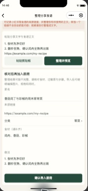
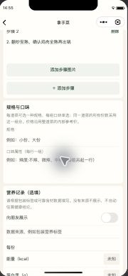

# 全页紧凑检查与参考功能补全实施记录

## TL;DR

- 0.3.0延续紧凑尺度，补全分类管理、原创菜谱库、收藏与想吃清单、分享文字导入、菜谱来源、分步做法、规格口味、手动营养、日期状态筛选、身份视角与关于页，共16个原生页面。
- 用户确认保持免费：营养手动记录，外部食谱由用户提供正文，展示真实厨房统计；不接付费AI、网页抓取或积分推广。支付与会员购买不在范围。
- 16页均在同一副屏原窗口用mock访问；修复分类按钮挤压名称、表单标签收缩，以及重复选择同厨房丢失当前饭局的问题。没有移动、调整窗口大小或全屏。
- 74项自动检查通过，主工程及四个云函数依赖审计均为0项漏洞。原生工具实际验证分享正文导入、分类排序回读、分步保存、大份规格进入点菜确认及厨师明细。
- 四函数已更新并回读Active；0.3.0开发版上传成功，主包221197字节。真实微信身份的旧厨房、新个人字段与12道菜谱库已只读回验。真实多人、图片回调、订阅送达与正式发布仍未验收。

## 部署坐标

客户端与源码版本0.3.0，免费开发云，四函数使用Nodejs20.19和3秒运行时。个人AppID、环境ID、身份缓存与密钥仅留在本机忽略配置中。原cloud配置按备份字节还原，设备mock数据与云端身份分开。

发布回执：四个部署均返回success=true；随后回读均为Active、Nodejs20.19、3秒。0.3.0开发版上传成功，主包221197字节（216.0KB）；预览编译成功，221129字节。没有提审或正式发布。

切回真实云模式后，在原生工具中读取既有厨房、随机展示UID与12道菜谱库，未出现演练标识或业务错误。没有向真实云写入mock角色、演练菜谱或演练饭局。首次云构建暴露分享解析器误放在仅demo打包目录的问题，已移入客户端公共服务；隔离云构建新增断言验证模块存在且可执行，最终预览和上传均通过。

## 对照参考图的结果

对照用户此前提供的35张参考图IMG8302–IMG8336，按功能核对；没有复制竞品菜谱正文、图片或付费权益文案。

| 参考图 | 功能 | 本次结果与边界 |
|---|---|---|
| 8302–8303 | 分类菜单、份数、邀请 | 延续紧凑横排菜卡与邀请；新增自定义分类名、显隐、分类和菜谱上下排序。 |
| 8304 | 点菜确认、份数与备注 | 保留人数、份数和私人备注；新增规格口味在草稿、确认与厨师明细中的完整保存。 |
| 8305 | 订阅提醒 | 主动订阅与拒绝后的微信设置入口已具备；真实云无模板时明确不可用，未证明送达。 |
| 8306 | 详情、食材、分步、营养 | 新增副标题、来源链接、带图步骤、做法标题与营养显示开关；营养必须有来源和计量依据，未知数值留空，不生成健康结论。 |
| 8307 | 用餐时段与自选时间 | 日期、时间和提前截止时间均可选；发布时间与截止顺序由服务端校验。 |
| 8308 | 厨房资料 | 名称、简介与封面编辑沿用；云图片仍受平台审核进入条件限制。 |
| 8309–8315 | 订单处理、状态、日期、用户筛选 | 饭局模式以锁单、确认制作份数、开始、上桌及说明不做原因承接；历史新增今天/近3/7/30天与精确状态筛选，厨师明细新增昵称筛选。请求份数与实际制作份数继续分开。 |
| 8316–8317 | 我的、UID、身份切换 | 新增可复制的随机展示UID、掌勺/点菜偏好视角；切换视角不授予厨房或厨师权限。 |
| 8318 | 成员管理 | 沿用口令邀请、本人确认加入、角色分配与撤销；没有按UID直接把他人绑定进私有厨房。 |
| 8319–8320 | 隐私、通知设置 | 保留导出、反馈、注销和私有权限；通知拒绝可跳转微信设置后再主动申请。平台路径仍待真实手机验证。 |
| 8321–8322 | 关于、权益 | 新增版本、免费范围、真实厨房菜谱/饭局统计及最近动态；按用户决定不做积分兑换、推广佣金和会员购买。 |
| 8323 | 搜索 | 菜单按菜名/食材、菜谱库按菜名/食材/介绍、历史按标题/日期搜索。 |
| 8324–8328 | 分类创建、修改、删除、排序、隐藏 | 自定义分类1–20个，名称最长12字；有菜的分类不能直接删除，需先移动菜谱。保留基础菜类供整桌推荐使用；不根据缺少依据的数据自动标注低脂或时令。 |
| 8329 | 菜谱库 | 内置12道自行编写的家常做法，可搜、收藏、展开食材步骤和批量导入；不使用竞品图片或正文。 |
| 8330 | 外部分享导入 | 从分享文字提取HTTPS来源、菜名、食材和步骤，预览核对后保存。只有链接时不抓取、也不伪造成功；视频需用户先整理文字。 |
| 8331–8333 | 想吃、收藏、批量导入 | 收藏按个人隔离；厨房成员可表达或撤销想吃，厨师批量导入；重复导入不复制菜谱，导入后清除对应想吃项；无会员付费阻挡。 |
| 8334 | 来源、副标题、规格、属性、内部价格 | 来源、副标题、最多8种规格与5组口味属性可编辑；每道菜的一次选择使用一个规格组合，同菜全部份数共用该组合，价格沿用整道菜的内部参考价。没有新增规格差价或收款。 |
| 8335 | 食材与自动辅助 | 食材、过敏原和完整性标记可编辑；免费辅助按换行拆分做法、按菜名和用时生成一句介绍，未标为AI服务。 |
| 8336 | 图片、步骤增删、营养开关 | 最多15个带图步骤，支持添加/删除、替换或移除图片、查询审核结果；保存与服务端均检查图片归属及审核状态。云图片当前关闭，不把mock图片当成真实审核。 |

## 数据与兼容

分类配置嵌在厨房文档，收藏放在个人文档，想吃清单放在厨房文档；不增加可被客户端直读写的集合。变更继续使用事务、预期版本与请求幂等键，撤销权限后不能复用旧请求获取越权结果。

旧菜谱缺少新增字段时按空内容读取，五个默认分类保持兼容。编辑菜谱不修改已发布饭局的菜谱快照；步骤图片的保留期清理同时检查当前菜谱和历史快照引用。菜谱编辑未传内部价格时保留旧价，显式清空才置空。

规格与口味由服务端按本餐快照验证，不能任意写入其他规格或未审核文字。份数汇总、制作计划和内部金额仍以菜为单位；当次选择不是多规格购物车，不支持同一人把同一道菜拆成多个规格行。

## 实际页面检查

设备为原窗口中的iPhone12/13(Pro)预设，工具缩放46%。下列16页均有原生截图与页面回读；未调整工具窗口或冒充320逻辑宽度、大字号或真实双端验收。

| 页面 | 检查内容 |
|---|---|
| 菜单、菜谱详情 | 菜名与说明换行、份数按钮、固定确认栏和原生tab；长菜名含规格口味可读。 |
| 饭局、掌勺、成员 | 点菜人数、私人备注、厨师明细、进度与成员管理入口；长规格明细换行。 |
| 我的、厨房、历史 | 昵称/UID、厨房列表、管理按钮、长饭局标题、日期和状态筛选。 |
| 发布、推荐 | 长表单、菜谱勾选、推荐内容与滚动到底后的按钮；未发现底栏遮住最后操作。 |
| 编辑、分类 | 分步做法、规格口味、营养输入与保存按钮；分类箭头固定宽度，避免名称竖排。 |
| 菜谱库、分享导入 | 收藏、想吃、导入按钮和长正文预览；确认按钮能滚动进入可见区域。 |
| 隐私、邀请、分享图、关于 | 隐私展开、导出入口、口令输入、分享图、免费说明、真实统计与动态。 |

原生mock实际执行：菜谱库收藏→朋友想吃→批量导入；分享正文→预览→导入厨房；分类下移→回读→恢复；导入菜谱→拆分步骤→保存规格口味→发布新演练饭局→详情选择大份→点菜提交→厨师明细显示完整组合。未向真实朋友发消息，没有新增真实微信测试账号。

| 分类排版修复 | 规格口味确认 | 厨师收到的明细 |
|---|---|---|
|  |  |  |

| 分享文字导入 | 分步编辑 | 关于与动态 |
|---|---|---|
|  |  |  |

## 验证

`npm run check`：类型、构建、74项测试与16页文件检查通过。新增用例覆盖分类权限/并发/旧快照、收藏隔离、想吃与成员退出、重复导入、丰富菜谱字段、来源校验、营养来源、非法规格、步骤图片引用保留、真实页面处理器串联和草稿规格保留。

`npm run audit:all`：主工程、api、publicRead、platformCallback、maintenance均为0项漏洞。Linux云部署目录单独安装依赖，四次安装审计也通过；没有开通付费服务。

本机原始证据在忽略目录`artifacts/parity-20261021/`，代码仓只保留手机区域裁图，不提交真实身份、个人路径、环境坐标或密钥。测试替身、原生工具mock、开发云与真实用户验收分别记账。

## 非阻塞事项登记

| 事项 | 影响与证据 | 为什么不阻塞本轮 | 后续动作与责任 |
|---|---|---|---|
| 两机多人、320逻辑宽度与系统大字号 | 本轮是同一模拟预设的mock；没有真实双端和窄机型截图 | 用户指定先用mock并保留原窗口；16页原生及74项回归已覆盖本轮路径 | 开发在用户准备体验成员后执行双端、窄机型和大字号验收；正式发布前必过。 |
| 图片审核与步骤图 | 可信平台回调与孤儿回收缺真实证据；本次只补编辑、归属校验和引用保留 | 云图片开关继续关闭，文字和分步正文可用 | 开发接通回调后按原03号记录验证正常、违规、早到、重复、超时与强杀，再开启。 |
| 订阅消息与小程序码 | 真实模板/送达、朋友圈与二维码路径未验 | 无模板时不承诺提醒，文字菜单与饭局动态可用 | 用户确认平台可用模板；开发完成授权、拒绝、额度耗尽及真实送达，码路径另验。 |
| 定时执行与真实恢复 | 维护任务已有配置，但仍缺独立平台触发回执；真实数据库恢复未演练 | 仅开发数据且云图片关闭，没有把自动清理或备份恢复写成完成 | 开发补触发游标推进、清理和隔离恢复证据；正式保留期承诺前必过。 |
| 正式发布 | 未备案提审与发布，开发上传不能代替 | 本轮只交付开发迭代版本 | 用户处理平台必要确认，开发协助并以实际回执结算。 |

开发工具按用户要求保持副屏原窗口打开，不退出，便于后续迭代。
