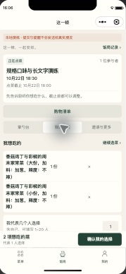
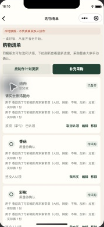
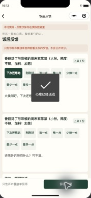

# 购物清单、饭后反馈与多规格实施记录

## TL;DR

- 0.4.0新增购物清单、饭后反馈，合计18个原生页面；同一道菜的规格和口味可分成多项点选、计价、确认制作及上桌，互不覆盖。
- 购物清单从厨师确认的实际制作计划生成，合并名称一致的食材；支持手填用量、补充项目、勾选和本人认领。没有自动推算食材克数。
- 饭后反馈在饭局结束且有菜上桌后开放。朋友填写自己的反馈，接单厨师查看本餐反馈；没有公开评分、积分或跨餐画像。
- 90项自动检查通过；原生开发工具实际走通两种规格→确认计划→生成、编辑、认领和勾选采购→分别上桌→保存饭后反馈。多人行为来自隔离演练，没有冒充真实多微信账号。
- 真实开发云已返回并渲染带小程序码的菜单海报。微信官方接口返回订阅类目和模板均为空，用户决定暂缓微信提醒；保留页面进度。腾讯真实图片回调、审核通过和私有图片解码已验证；多人手机和正式发布不在本轮范围。

## 部署坐标

客户端版本0.4.0，四个开发云函数使用Nodejs20.19及3秒运行时。本轮继续使用既有免费开发环境，不开通付费服务、不提交微信审核、不正式发布。真实AppID、环境ID、登录身份及密钥只留本机忽略配置和云平台。

四个函数本轮部署均返回success=true，随后回读均为Active、Nodejs20.19、3秒。0.4.0最终预览和开发上传均成功；预览包246561字节、开发上传包246629字节。没有微信提审或正式发布。

## 功能与权限

| 功能 | 最终行为 | 边界 |
|---|---|---|
| 多规格点菜 | 详情选择规格和口味后，增减当前组合；切换组合会显示该组合的已有份数，其他组合保留 | 同菜合计最多20份；个人最多60项，本餐最多80种组合；旧单规格数据兼容 |
| 汇总与制作 | 菜单按菜统计总份数；厨师按组合看需求、定实际份数和逐项制作 | 想吃人数、请求份数、实际份数继续分开；不自动把点菜变成制作或采购量 |
| 内部参考价 | 可设置规格默认价，本餐每种组合也能独立改价；发布时保存价格快照 | 仅具有菜谱价格权限的人编辑默认价，仅本餐接单厨师查看本餐价；不收款，朋友与公开摘要不返回金额 |
| 购物清单 | 生成已确认且未跳过的制作项食材，按完整食材文字去重；保留手填用量、勾选、认领和手动补充 | 不合并名称不同的食材，不猜克数；计划变化提示更新；取消的饭局只读 |
| 清单协作 | 本餐参与者均可勾选、认领自己；接单厨师或添加者编辑与移除，厨师可释放认领 | 使用独立版本防止覆盖；退出、移除或注销时清理身份关联；被撤权后拒绝读写和旧请求重放 |
| 饭后反馈 | 已结束且至少一道菜上桌后，可对上桌组合选最多3个标签、写短评及整餐留言 | 每人只能编辑自己；接单厨师分批查看所有当前参与者反馈，普通朋友只能看自己；不评价未上桌项 |
| 分享 | 受邀加入卡片与公开菜单卡片分开；菜单海报中的小程序码只指向主动公开的标题和菜名 | 不包含邀请口令、成员、时间、备注或价格；撤销后入口失效，已保存图片无法收回；真实手机扫码另验 |
| 进度提醒 | 页面读取本餐制作进度，提醒拒绝或未配置不阻塞点菜 | 用户明确暂缓微信订阅提醒；本轮不承诺系统通知送达 |

`shared/selection.js`统一组合标识，口味属性顺序不同仍视为同一组合。`domain/demand.js`聚合需求与价格；`domain/meal-tools.js`管理购物和反馈，数据保存在饭局文档中，没有新增客户端可直读写的集合。事务、请求幂等、角色检查和版本冲突沿用既有入口。

新规格组合标识与反馈内部存储键使用32位字母数字，按[CloudBase字段约束](https://cloud.tencent.com/document/product/876/18436)避免使用带特殊字符的字段名；旧普通菜品标识保留兼容。

离开购物或反馈页面即清空私有内容；较晚返回的请求不能在隐藏页面重新填回数据。个人导出只包含有权读取的购物内容及本人反馈，不输出其他人的反馈或内部价格。编辑菜谱不修改已发布饭局快照。

## 原生页面验证

继续使用副屏原窗口的iPhone12/13(Pro)预设和46%缩放，不移动、调整大小、全屏或退出开发工具。本轮新增云控制台窗口由用户明确授权。下面图片只裁取隔离演练的手机区域。

| 两种规格分别点菜 | 按实际计划采购 | 保存饭后反馈 |
|---|---|---|
|  |  |  |

实际演练保留大份1份，再添加小份1份；购物车和制作计划显示两项。鸡肉、香菇、彩椒各显示两个制作来源；把鸡肉改成500克、添加采购备注、本人认领并勾选。大份先上桌时小份仍是待制作；分别完成后，对指定组合选择“下次还想吃”并保存留言。

真实云模式只读取既有厨房和饭局、生成本人主动公开摘要及海报、提交自行绘制的小图进行平台审核。没有把演练角色、菜谱或饭局写入真实云。原生海报已显示真实开发版小程序码及保存入口，没有代替用户保存到相册或发给朋友。

## 平台能力的证据

- 分享码：真实微信`wxacode.getUnlimited`成功返回图片，约64KiB；原生海报画布实际渲染完成。开发版配置`SQUIDDY_CODE_ENV=develop`并关闭正式页面发布校验；正式版本须切回release。消息跳转版本另用`SQUIDDY_MESSAGE_ENV`，不混用两套枚举。
- 提醒：真实`subscribeMessage.getCategory`和`getTemplateList`均返回成功且列表为空；用户已选择暂缓。保持通知不可用和页面内进度，不自动选模板、不模拟用户同意。
- 图片：已配置`event / wxa_media_check`到既有回调函数，并启用、刷新回读；真实上下文的来源为`wx_callback`，同时携带本应用APPID和OPENID。代码只对这个已验证来源接纳OPENID，继续拒绝客户端调用链、HTTP和跨应用来源。实际`mediaCheckAsync`提交后，新图收到回调并变为approved；待审图片不能绑定菜谱或展示。鉴权接口读取私有文件后，微信SDK成功解码81×81 JPEG测试图。
- 定时维护：官方只读查询获得平台维护状态，完成时间有推进；这证明定时执行，不等于孤儿文件回收、批量注销、云备份恢复都完成了真实故障演练。

## 本轮修复的实际问题

1. 消息路由保存后仍处于停用状态。回读列表发现“启用”按钮，开启并再次回读为“停用”后才收到真实回调；今后配置必须同时核对路由与启用状态。
2. 原校验拒绝所有携带OPENID的回调，误拦真实`wx_callback`。已按实际SDK来源适配；伪造与跨应用用例仍拒绝。
3. 免费环境3秒超时曾让客户端收到失败，但同一上传任务已经持久化为pending且有trace。客户端现在先回读原任务，不自动重传；上传凭据保留，之后可继续查审核结果。
4. 已审核图片的临时HTTPS地址被下载域名检查拒绝。新页面经`media.content`鉴权接口读取私有图片内容，写入本机私有渲染缓存，不放开存储规则，也不关闭域名检查。图片输出限制512KiB，必要时再压缩；启动与账号停用清理本应用缓存，菜单不预取全部步骤图片。

## 自动验证

`npm run check`通过类型、构建、90项测试及18页完整性检查。用例覆盖同菜多规格、默认价快照、逐项制作与撤销、清单权限与并发、生成保留、计划变化、反馈范围、撤权重放、个人导出及隐藏页面的延迟请求。

主工程和四个函数依赖审计均为0项漏洞。Linux部署包单独安装锁定依赖；云构建确认共享组合模块存在，不携带演练业务引擎。原生运行时另回读确认新组合标识为32位，避免只验证源码而未加载最新构建。原始回执与原生截图保存在本机忽略目录`artifacts/complete-20261021/`，公开仓库不含平台身份、密钥和云文件地址。

## 尚未验收与用户暂缓事项

| 事项 | 影响与证据 | 是否阻塞、后续动作与责任 |
|---|---|---|
| 微信提醒 | 类目和模板为空，用户决定暂缓 | 不阻塞本轮其余功能；用户未来选定可用模板后，开发核字段与实际授权、发送结果 |
| 多人真机、扫码与朋友圈 | 用户本轮明确暂不做；没有真实双端或多微信证明 | 不阻塞本轮开发迭代；进入真实验收阶段再由用户安排账号设备，开发执行并分别记账 |
| 旧测试图片与故障恢复 | 调通前的测试图片仍有pending，均未绑定菜谱，受24小时过期清理；没有完成上传瞬间强杀、孤儿文件清单回收和云备份恢复演练 | 不阻塞本轮开发版功能；不承诺正式保留期或恢复能力。开发正式发布前完成独立环境演练，并核对测试文件到期清理 |
| 微信提审、备案与发布 | 本轮明确不提审，没有正式发布回执 | 不阻塞开发版；用户处理账号和平台必要确认，开发按后续明确授权推进 |

周菜单、冰箱、食材自动换算、做菜模式、长期家庭偏好、付费AI和网页抓取本轮均未加入。

## 0.4.1后续故障演练

本记录保留0.4.0交付时的边界。图片清理与云备份恢复后续已独立推进，当前证据与剩余状态以[07号演练记录](20261021_07_图片清理与云备份恢复故障演练实施记录.md)为准；微信提醒、多人真机与提审仍由用户暂缓。
