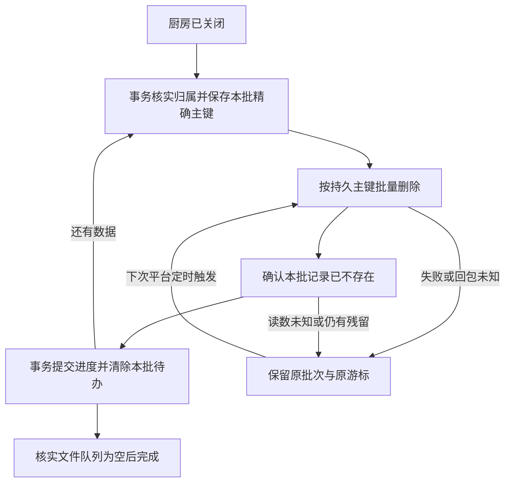

# 自动回收调度修复与真实验证实施记录

## TL;DR

- 旧实现每次触发只扫一张表的5条记录，空表也等待下一轮，读取范围还包含其他厨房。上一轮79批、约6.5小时是离线推演，不是实测完成时间。
- 本轮改为按资源归属筛选、常规关闭厨房记录每批最多50条、同次触发按剩余预算继续推进；复杂成员或图片处理仍用小批。保留原每5分钟一次定时器、3秒函数时限和来源校验。
- 真实调度验证进一步暴露只读扫描事务开销。调度游标与候选列表改用普通只读查询，已关闭厨房先持久化精确删除批次，确认记录消失后才推进游标；图片和成员变更仍保留事务检查。没有通过增加付费资源或开放客户端管理入口提速。
- 真实平台定时器已完成41场技术历史、关联数据、实际云文件和技术用户索引回收；原9表逐项未变，本轮技术元数据已精确清除。样本由管理员种入，仅证明真实调度回收，不替代明天真实40场审核发布验收。
- 144项本地检查通过，包含60条历史已完成任务不阻塞新任务、通知队列仍能推进、删除后丢回执续跑和活跃厨房禁止批量删除。真实微信账号完整注销仍缺专用身份，不能删除现用主人来补验收。
- 审核日额度已由真实平台错误确认；具体账号上限、作用范围和重置规则仍缺权威读数。继续检索可访问的官方CloudBase资料未得到这些账号事实，不能引用第三方默认数值冒充。明天09:00按原计划验收；微信提醒、多人真机和提审继续暂缓。

## 部署坐标

最终代码提交为dc54c26，仅更新maintenance函数。客户端版本维持0.5.2，不产生新的客户端开发版，也未提审。部署使用带Linux依赖的准备包，平台回读Active、Nodejs20.19、3秒。触发器为既有squiddy-maintenance，每5分钟一次。原免费开发环境和数据库访问规则保持既有配置。

## 现场与根因

| 层次 | 已核实机制 | 修复与证据 |
|---|---|---|
| 每次工作量小 | runtime对每个清理任务只调用一次cleanupBatch，参数固定5；20张表逐张推进 | 关闭厨房常规数据每批最多50条；单次触发在预算允许时最多继续12批，复杂表保守处理 |
| 无关数据放大 | cleanupBatch按整张表读取后在本地判断归属；别人的记录也消耗游标、读取和触发次数 | 查询同时带任务归属和主键游标；保留逐行二次归属及成员代次检查 |
| 固定空等待 | 空表也要下一次触发才能推进 | 同一事务在剩余预算内跨过空表；进度写入成功后才生效 |
| 真实平台耗时 | 15:05定时触发已更新maintenance_state，但新清理任务仍pending、last_processed为0 | 调度游标读取与候选扫描改成普通只读查询，避免每个只读扫描的start/get/commit开销；继续用后续真实触发验证 |
| 原有验证缺口 | 过去手动推进和内存回归没有覆盖真实调度完成时间与真实事务往返 | 本轮不手动调用maintenance，不伪造SOURCE，以平台触发写入的进度及存储残留回读验收 |

另外，核对实际依赖源码发现当前SDK的Query.remove没有携带transactionId，不能把它当作事务内删除。真实15:10、15:15触发又确认同一事务并行删除会被TransactionBusy拒绝；失败批次41条记录完整保留、游标未前进。改为串行后，15:20删完20条并提交了本批游标，但记录的执行跨度超过3秒且全局调度游标没有更新。单纯放大事务批次仍不满足预算。

最终对已关闭厨房采用持久批次协议：事务内核实厨房closed、筛选归属并保存精确主键及提交后游标；事务外按这些主键进行幂等批量删除，并回读确认不存在；再次事务核对批次token，提交游标并清除待办。删除已成功但确认丢失时，只重复同一批，不跳过记录或重复累计进度。厨房一旦关闭，业务接口禁止继续写入；备份恢复创建新厨房和新主键，不会把旧厨房重新开放。该路径不用于活跃厨房、账号或成员清理，避免破坏重新加入代次与共享图片保护。

## 删除批次的恢复路径

## 实现与边界

| 文件与函数 | 最终行为 |
|---|---|
| domain/maintenance.js: cleanupBatch | 校验任务种类和归属ID；按任务资源读取；空表在预算内合并推进；关闭厨房的精确批次持久化后才删除、回读后才提交；记录进度及平台触发元数据；完成前核实文件删除队列为空 |
| cloud/shared/runtime.js: maintenance | 用只读接口读取调度游标和候选；仅扫描pending/running清理任务，旧游标到末尾时同轮回到开头；只为确实到期的媒体预留复杂处理时间，未到期或无到期值的媒体不阻塞后续队列；关闭厨房的持久批次启动预留700毫秒，复杂账号/成员预留1200毫秒；沿用队列轮转与时间预算；在预算内继续推进；保留wx_trigger可信来源校验 |
| cloud/shared/store.js | 提供只有get/getMany/scan的read接口；OR资源条件与主键游标同时应用；关闭厨房批量删除后检查精确主键已不存在；其他写入沿用事务 |
| domain/store.js | 隔离测试适配器支持同样的范围读取；内存回归不作为平台性能证据 |

批量删除只发生在已经持久化并核对归属的明确主键上，实际数据删除和游标提交分成可恢复的两个阶段，不宣称跨阶段原子性。文件删除仍由持久队列执行；删除失败或结果未知时任务不能提前completed。回收不会立即删除仅含actor/action/result的厨房操作回执和审计，其既有保留期仍为30天；本轮技术元数据在验收后按私有清单精确清理，不能按现用主人actor整批删除。

存在pending_delete未确认批次时不直接降级维护函数。回滚前先完成或安排兼容恢复该批次，并保留任务和文件队列；旧代码不执行新的恢复协议。回滚会恢复慢速推进，不能保证本轮改善幅度。

## 真实调度验收

状态：已验证并清理。全部业务删除与文件回收由真实wx_trigger平台事件执行，原触发器名为squiddy-maintenance，未手动调用或伪造来源。时间均按北京时间展示，时长只比较同一云端运行时记录的started_at与completed_at，不混用本机提交时间。

| 云端时间 | 回读结果 |
|---|---|
| 15:10:02.044 | 首次提交任务进度；随后两次尝试的TransactionBusy已记录，并确认失败批次未跳过 |
| 15:20 | 串行20条删除提交，但跨度超过配置时限且未落最终调度游标，促成持久批次方案 |
| 15:30 | 余下21条饭局成员由平台删除，调度游标正常落库 |
| 15:45 | 媒体记录删除并进入文件删除队列 |
| 15:50 | 实际云文件消失，独立云存储列表回读为0 |
| 16:10 | 最终版本在一次平台触发内确认删除41条饭局价格和41条饭局记录，累计明细删除127条 |
| 16:15:05.451 | 技术用户厨房索引自然清空且档案保留，文件队列无残留，厨房删除、任务completed |

这组样本从云端首次推进到完成为65分03.407秒，包含现场排查、中间失败版本和更版等待。它不是最终版从零开始的性能基准，也不能与旧版79批的离线6.5小时推演直接作纯性能倍数比较。最终版接手时已有45条明细被前序版本删除；此后两次自然触发完成余下82条、用户索引及任务收尾。明天真实SDK生成的41场历史场景将补测最终版从关闭任务created_at到completed_at的全程耗时。

最终任务记录扫描128条、明细删除127条、10次数据推进批次，另在完成阶段删除厨房1条；技术用户只移除厨房索引，不自动删除档案。任务保留了8个成功提交元数据的触发标记，该数不包含未处理本任务或失败回滚的触发，不是平台总调用量。技术样本写后均回读，原有真实用户的厨房索引没有加入技术厨房。

| 样本 | 数量与来源 |
|---|---|
| 待回收厨房、菜谱、菜谱价格、厨房成员 | 各1条，明确技术标记，由可信管理员创建 |
| 取消状态饭局、饭局价格、饭局成员关系 | 各41条，同一技术厨房；不是41次真实审核发布 |
| 媒体及实际云文件 | 1条媒体、1个实际上传的文本验证文件，均已由真实维护流程删除 |
| 技术请求回执、技术审计 | 各85条，模拟正常保留元数据；用于验证不误当作厨房业务残留 |
| 技术用户档案 | 1条管理员种入、无openid的技术记录，已由自然回收移除厨房索引并保留档案；随后按精确ID清除技术档案 |
| 原有业务 | 9个业务集合各1条，写前快照独立保存；结束后逐项比较内容，不只比数量 |

最终回读同时确认：平台触发元数据为wx_trigger及原触发器名、任务completed、目标业务与文件队列无残留、技术用户的厨房索引已清空而档案仍在、云存储文件确实不存在、原9表逐项未变。完成证据先保存到私有档案，再通过既有管理员工具精确删除85条技术回执、85条技术审计、1条本轮失败诊断、1条技术档案和1条已完成技术任务；写后逐组回读为0。原9个业务集合均各1条且内容逐项相等，原主人与原厨房保留。

本地完整检查144项通过；根工程和四函数依赖审计均为0漏洞。旧CI一次遇到npm审计服务的退役端点错误，之后同依赖审计重跑通过；最终代码dc54c26的[远端CI](https://github.com/AMortalsOdyssey/squiddy/actions/runs/39745479834)全绿，包含144项回归与依赖审计。

开发工具收尾时，模拟器画面仍显示app.json缺失，而实际文件存在、逻辑运行时可读菜单页。将本地受忽略配置的源码目录恢复为示例一致的miniprogram/写法，触发配置重载并重新编译后，原生画面已恢复菜单。未因此修改业务源码、重启开发工具或移动窗口；不能仅凭CLI接受刷新请求就认定画面已经恢复。

## 审核配额继续追查结果

本轮重新尝试原Chrome入口仍被工具的站点安全策略直接拒绝；未换浏览器、脚本或代理绕过。此前用户截图是developers.weixin.qq.com的开发文档页，不是账号后台；它没有该账号的上限、已用量或配额重置入口。用户最新说明Chrome没有打开，当前没有可读取的账号后台菜单，停止继续让用户盲找。

继续检索可访问的官方CloudBase资料：其[云调用权限说明](https://docs.cloudbase.net/en/faq/knowledge/cloud-call-604101-permission-error)确认msgSecCheck通过云调用使用、权限缺失对应-604101；这与本次明确daily quota的45009不是同一种失败。资料未给出当前账号的额度读数，也未证明按AppID、用户或通道中的哪一层计数。另在CloudBase[企业微信群机器人示例](https://docs.cloudbase.net/recipes/connect-wecom-webhook-cloud-function)中查到45009按机器人分钟频次解释，该接口与msgSecCheck不同，已排除，不能拿同一个错误码的别处说明确定本应用上限。本应用daily结论仍以本账号实际SDK的平台说明为准。没有把搜索到的QQ小程序限额、第三方旧文或其他账号的经验数值套到本应用。

本地代码可以确定业务消耗口径：空文本0次；非空汇总文本按窗口检查，一次业务写入可能为1至3次；逐道菜恢复分别审核；成功回执重放、满额前置拒绝、取消与关闭厨房不调用文字审核。它不能确定微信计费/配额是否将失败调用、云调用重试、其他接口或其他环境合并计数。需要账号权威用量页或平台提供的明确规则才能回答具体日上限及这些计数范围；站点访问被拒绝是本轮取得该证据的实际阻断，不能通过批量调用试探上限。

本轮验证范围为41场技术历史、1个实际文件及1条技术用户索引。即时关闭与后续物理回收分别判断；不将本次观察时间推广为多任务并发、数千条历史或多图片场景的完成时限保证。

## 后续动作与责任

| 事项 | 当前边界、影响 | 动作与责任 |
|---|---|---|
| 当前真实调度验收 | 已completed，文件及本轮数据清理确认，原9表逐项未变 | 本轮关闭；Agent保留私有完成与删除回读证据 |
| 审核具体配额 | 缺账号数值、完整用量、作用范围、重置规则；仍阻塞承载量保证 | Agent在允许访问的权威入口恢复后获取；不购买、不绕过、不用调用试探代替 |
| 明天真实满额发布及最终版全程回收耗时 | 本轮种数不能替代真实审核发布；65分钟含更版，不是最终版从零耗时保证 | 2026-10-23 09:00原自动化先检查额度，恢复后完成40场、有效第41场拒绝、释放重发、同请求重放与清理；以云端任务created_at和completed_at补测最终版完整回收耗时 |
| 完整真实身份注销 | 仍缺专用真实测试身份，现用主人必须保护 | 条件具备后Agent执行真实身份到文件回收验证；本轮仅提供回收机制的调度证据 |
| 微信提醒、多人真机和提审 | 用户明确暂缓 | 保持暂缓 |
